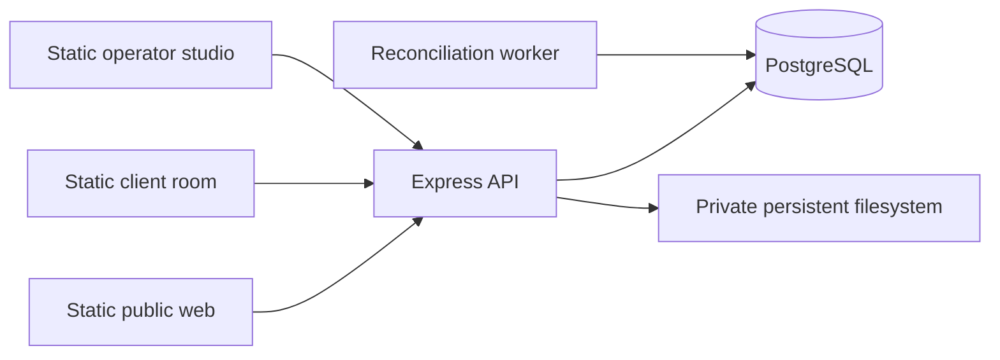

# Architecture and decisions

## Audited starting point

`Toti-Gauna/Northstar-studio` was cloned empty (no commits, package manifest, lockfile or applicable AGENTS.md). No existing work was replaced. The supplied three Notion pages were fetched on 2026-10-12; this user's self-contained specification overrides historic sequencing and implementer references. No other agents, projects or shared databases were used.

Official Next installation/static-export and GSAP React/matchMedia documentation were consulted. Next requires Node ≥20.9; this project's baseline is Node ≥22 and observed runtime is 24.19.0. Installed versions are fixed by `package-lock.json`, not inferred from this document. Drizzle's documentation endpoint returned HTTP 403; the installed API/types and DB integration were verified instead. The ORM was updated to 0.45.4 after dependency audit identified an advisory in 0.44.7.

## Boundaries

`packages/contracts`: Zod schemas, localized content shapes, integer pricing and types. `apps/api`: thin routes, authorization, domain services, Drizzle schema/migration, seed and reconciliation. `apps/web`: tokens/primitives, scoped queries, screens and GSAP scenes. Heavy portal views load on demand. API/worker/migrator compile to ESM; the frontend exports HTML/assets. No Server Actions, API routes, SSR runtime, external LLM or SaaS backend are needed.

## Static routing

Fixed exported routes: `/`, `/services/`, `/service/?id=…`, `/cases/`, `/process/`, `/faq/`, `/brief/?service=…&package=…`, `/client/?view=request&id=…`, `/operator/?view=request&id=…`. Projects and other portal views also use query parameters. These shells handle arbitrary new IDs after export. IDs grant no authority. Content changes are fetched from the API without rebuild.

Hostinger must serve directory `index.html` files and preserve query parameters. Pages supports the same export. No blanket SPA rewrite is necessary; do not rewrite assets/API requests to the homepage. `scripts/static-headers.mjs` generates CSP script hashes from actual exported inline scripts. Rebuild headers when artifacts or API origin change. Apply equivalent headers manually on Hostinger if `_headers` is unsupported.

## Entities and JSON tradeoffs

18 relational tables cover workspaces, users, sessions, content, leads, comments, quotes, versions, acceptances, projects, milestones, tasks, attachments, audit, outbox, inbox notifications, idempotency and brief drafts. Users carry their workspace membership/approved identity; there is no separate global owner or production login. A workspace brand JSON includes sector, language, currency and timezone.

Validated JSON is used for service/package/question/template configuration, catalog/content revision history, brief answers/origin and immutable quote options/lines/scopes. It avoids duplicating table trees for three catalogs. Public revision and private draft are separate fields. Lead captures the full service revision; sent quote captures full brand/service/customer/line/scope/terms/totals. Project captures the exact chosen option. JSON is validated on write/publish and never serves as an authorization boundary.

Relational constraints enforce unique quote per lead, `(quote, revision number)`, acceptance per quote/version, project per lead/acceptance, user identity per workspace and idempotency per workspace/user/operation/key. FK relationships and workspace/status checks supplement role/ownership checks. A DB trigger prevents mutation of sent snapshot/hash/PDF/sent/expiry fields and reopening accepted versions. API queries always scope by workspace and customer ownership where applicable.

## Sessions, roles and command concurrency

A random 256-bit opaque session cookie is HttpOnly; only its SHA-256 hash is stored. No JWT/session signing secret is needed because server sessions are authoritative. CSRF tokens rotate on role switch. Origin validation is exact for every mutation; authenticated commands also require the session CSRF token. Cookies use configurable Secure/SameSite; expiry and reset invalidate old access. Rate limits and workspace quotas apply.

The server resolves identities from the active workspace's user records. It does not accept arbitrary user/workspace IDs as authority. Commands lock the workspace row and revalidate the session/user/state/TTL inside the transaction, serializing demo writes and preventing reset/role races. This deliberately favors correctness over high throughput. Read queries do not transition business states. Authorized downloads emit audit events.

Browser query keys include workspace/user; switching role cancels pending queries and clears cache. Briefs are saved to private DB drafts with a bounded debounce; no brief PII/business entities are persisted in localStorage. Session storage contains only language preference. Logout/reset clear application cache and cookie. The app must have working cookies to participate in a demo.

## Money, lifecycle and acceptance

Money is integer minor units; quantities are integer hundredths; percentages are basis points. Line = half-up `(quantity100 × unitMinor) / 100`. Sum rounded lines; discount half-up on subtotal; tax half-up on discounted net; total = subtotal − discount + tax. Calculation uses BigInt and checks supported amount bounds. No mixed-currency quote, browser total or implicit FX conversion is accepted. Tax is configurable example data, not advice.

Lead: new → qualified → quoted → won/lost. Drafts can be edited; sending freezes one version and supersedes a previous sent version. Creating a draft alone does not revoke a sent proposal. Declined/lost/accepted work cannot be reopened; a new scope requires a new brief. Only current, sent, unexpired, owned proposals can be accepted. Repeat exact acceptance returns the original project; another option/version conflicts.

Acceptance locks and inserts the exact version/option/user/amount/currency/hash, lead won, project, template milestones/tasks, audit and local notifications in one transaction. Constraints plus serialized DB command locks protect simultaneous requests. It is a recorded confirmation, not certified signing or payment.

## PDFs and uploads

PDFKit generates at send time from the snapshot only, using a self-hosted licensed Instrument Serif headline font and standard readable UI PDF fonts. File location/hash is frozen with the version. Download verifies hash and authorization, never regenerates from mutable catalog. A PDF includes the version's alternatives; the acceptance record/project separately identifies the one selected option. No private comments enter the PDF.

Private filesystem storage uses UUID filenames, restricted modes, metadata hashes and authorized downloads. Uploads: UTF-8 TXT, structurally parsed passive unencrypted PDF (≤100 pages), validated PNG/CRC/dimensions, ≤2 MB/file, workspace file/byte quotas. PDF parsing inspects compressed objects and encoded names for scripts/actions/embedded content. HTML/SVG are excluded. This is not a production antivirus service.

In deployment use an explicitly durable mounted disk and absolute STORAGE_DIR. The prepared Render blueprint requires a reviewed paid persistent disk; it does not provision one. An ephemeral Render filesystem is unsuitable. S3/R2 integration was not required and is not represented by empty adapter code.

## Durable expiry and local reminders

Worker scans active workspaces with row locks/SKIP LOCKED, expires sessions/workspaces, transitions overdue sent versions and writes local reminders two days before expiry. Unique dedupe keys prevent repeated reminder effects across workers/restarts. The DB is the source of truth; browser timers only guide the optional tour. Acceptance checks wall-clock expiry even if the worker is stopped. GET displays effective expiry without mutation.

Reset/TTL retain inaccessible historical rows/files for review; automatic storage garbage collection/retention deletion is a production follow-up, explicitly documented in the runbook. Workspace quotas cap individual demo usage but do not replace global abuse/storage capacity policy.
